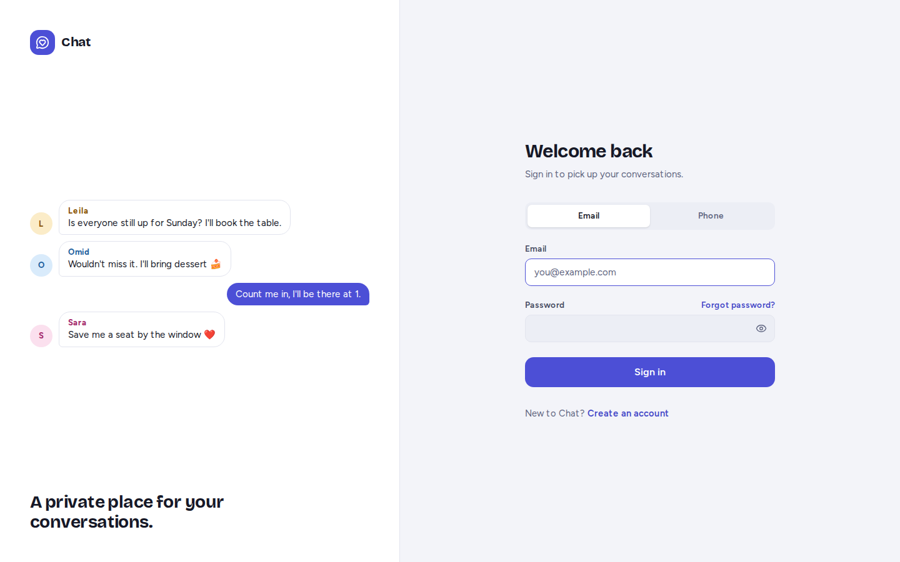

<div align="center">

# Chat

**A full-stack messaging application for conversations, communities, and real-time communication.**

[Features](#features) · [Quick start](#quick-start) · [Architecture](#architecture) · [Development](#development) · [Documentation](#documentation)

</div>

## Overview

Chat brings direct messages, groups, and channels together in a responsive web application. The repository includes a Next.js client, a NestJS API, and an administrative panel.

## Preview



*The sign-in screen, captured from a clean local instance.*

## Project status

**Active development.** The main messaging client and API are implemented, with automated checks. The admin panel is **work in progress**: sign-in, user administration, recovery, tickets, and audit pages exist; the planned reports queue, channel administration, analytics, and admin-management screens are not yet present. The admin panel is not included in the one-line local setup.

## Features

- **Conversations:** direct messages, groups, channels, invite links, and searchable public communities.
- **Rich messaging:** replies, edits, reactions, pins, read receipts, files, voice and video messages, stickers, and animated emoji.
- **Real-time interaction:** Socket.IO events for messages, presence, and typing; LiveKit integration for calls.
- **Community controls:** owner and administrator roles, granular permissions, moderation, and member exceptions.
- **Personalization:** themes, wallpapers, chat folders, profiles, and accessibility-oriented motion settings.

## Quick start

For a **local evaluation**, install Git, Docker with the Compose plugin, and OpenSSL. Then run:

```bash
curl -fsSL https://raw.githubusercontent.com/MasterAkbariDev/chat-app/main/install.sh | bash
```

The installer asks for an installation directory and local web and API ports, clones the repository, generates a signing secret, and builds the containers. It refuses to overwrite an existing directory. With the default ports, open **http://localhost:3000**; API documentation is at **http://localhost:3001/docs**. The command requires access to this repository; the raw URL will be available without authentication once the repository is public.

This setup is intended for a local machine. It uses local database and cache services and does not configure calling, browser push, TLS, or production hosting. First builds can take several minutes. To inspect logs or stop the stack:

```bash
cd chat-app/backend   # or the directory selected during installation
docker compose logs -f app frontend
docker compose down
```

The database and uploads are retained in Docker volumes when the stack is stopped.

## Architecture

| Component | Responsibility | Main technologies |
| --- | --- | --- |
| [Web client](frontend/) | Messaging interface and real-time client | Next.js, React, TypeScript, TanStack Query |
| [API](backend/) | Authentication, messaging, media, and real-time events | NestJS, Socket.IO, MongoDB, Redis |
| [Admin panel](admin-panel/) | Administrative workflows | Next.js, React, TypeScript |
| Infrastructure | Local persistence and optional media/calling services | Docker Compose, MinIO, LiveKit |

See the [system architecture diagram](docs/architecture-overview.md) for the runtime relationships. The browser communicates with the API over HTTP and Socket.IO. MongoDB stores application data, Redis supports real-time delivery and rate limiting, and media can be stored on disk or in S3-compatible storage.

## Development

Each application has its own Bun lockfile. From the relevant directory, install dependencies with `bun install --frozen-lockfile`. See the component documentation for environment variables and service requirements.

```bash
# API
cd backend
bun run typecheck
bun run test
bun run build

# Web client, in a separate terminal
cd frontend
bun run test
bun run build
```

The root GitHub Actions workflows cover type checking, linting, tests, and builds. Production deployment requires additional configuration; see the deployment documentation before exposing any service to a network.

## Documentation

- [Backend](backend/README.md)
- [Web client](frontend/README.md)
- [Admin panel](admin-panel/README.md)
- [Architecture and project documentation](docs/README.md)
- [Deployment](docs/DEPLOYMENT.md)
