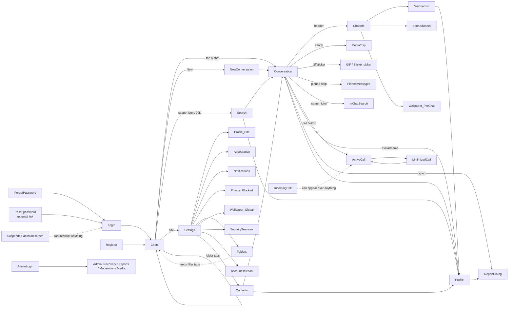

# Frontend Pages, Options & Navigation — reference for AI-assisted frontend design

Companion to `BACKEND_FEATURES_AND_DATA.md` — that document says what data/actions exist; this one
says what screens they turn into and how a person moves between them. Written for handing to a
design tool alongside the backend doc.

**Before designing from scratch, know what already exists:**
- `chat-app/frontend-design/` — 9 design-canvas artboards already cover Login, the desktop
  chat-list+conversation view, mobile chat-list, mobile conversation, the new-conversation sheet,
  Settings, a shared primitives sheet, a "bento" chat-info panel, and a ⌘K command palette. Open
  `canvas.json` there to see them laid out.
- `chat-app/frontend/` — a real Next.js app already implements most of the pages in section B–E
  below against the live backend (auth, chat list, conversation, reactions, edit/delete/pin, read
  receipts). `docs/plans/FRONTEND_PLAN.md`'s status table says exactly what's live vs. aspirational.
- The pages **not** covered by the existing canvas — and the most useful place for a new design
  pass to focus — are marked **NOT YET DESIGNED** below: Calls, GIF/Sticker/Wallpaper pickers,
  Contacts, Folders editor, Notifications settings, Reporting, and the entire Admin panel.

**Platforms:** one responsive web app (mobile web + desktop, per the existing canvas's separate
Mobile/Desktop artboards) is the near-term target; a native Flutter app is a separate, later plan
(`docs/plans/FLUTTER_APP_PLAN.md`) and out of scope here.

**Navigation shell:** two top-level destinations — **Chats** and **Settings** — plus a persistent
"New" action and a global search entry point. Everything else is reached *from* a chat, a
settings page, or a profile, not from its own nav-bar item.

---

## A. Auth & onboarding (no nav chrome — full-bleed)

### A1. Login
- **Options:** email-or-phone field, password field, "Forgot password?" link, "Create account"
  link.
- **States to design:** wrong credentials, account locked (5 failed attempts → 15 min), account
  suspended (distinct message, see §J2).
- **Navigates to:** Chats (success) · Register (A2) · Forgot Password (A3).

### A2. Register
- **Options:** username, email, password, optional first/last name, optional phone number.
- **Navigates to:** Chats (success, auto-logged-in — no email verification step exists).

### A3. Forgot password (request)
- **Options:** one field — email, phone, or username.
- **Result state:** a neutral confirmation ("if that account exists, an admin will review your
  request") — never confirms whether the account exists, and never promises an emailed link,
  since recovery is admin-mediated (§ Backend doc §1).
- **Navigates to:** back to Login.

### A4. Reset password (landing on an admin-issued link)
- **Entry point:** external — a link an admin sends the user out-of-band, not reachable by
  navigating the app itself.
- **Options:** new password field, confirm field.
- **States:** valid token → set password → redirect to Login; expired/already-used token → a
  clear dead-end state (no retry, since the token can't be reused — direct them to request again).

---

## B. App shell (present on every authenticated page)

- **Primary nav:** Chats · Settings.
- **Persistent "New" action:** opens the New Conversation sheet (§ E).
- **Global search field/icon:** opens Search (§ F).
- **Command palette (⌘K / Ctrl+K, desktop):** quick-switch between chats, jump to settings pages,
  start a new chat — a power-user shortcut layer over the same destinations, already designed in
  `CommandPalette.dc.html`.
- **Presence/connection indicator:** subtle, auto-hiding — only visible when the socket is
  reconnecting.
- **Incoming-call banner/modal** (§ H1) can appear over any screen — it isn't tied to being on the
  Chats or a specific conversation screen.

---

## C. Chats (home)

### C1. Chat list
- **Options per row:** avatar/group image, name (or the other person's name for a DM), last
  message preview, timestamp, unread badge, pinned indicator, muted indicator, swipe/hover actions
  (pin/unpin, mute/unmute, mark read, delete/leave).
- **Filter/folder tabs above the list:** All plus each folder the user has defined (§ G6) —
  server-filtered, not client-side.
- **Empty state:** no chats yet → prompt to start one (→ New Conversation).
- **Navigates to:** a Conversation (D1, tap a row) · New Conversation (E1, the "New" action) ·
  Search (F1) · Settings (G1) · Folder editor (from a "manage folders" affordance near the tabs).

---

## D. Conversation

### D1. Conversation view (the core screen)
- **Header:** chat name/avatar (tap → Chat Info, D2), member count (group/channel), mute toggle,
  call button (→ H, if not a channel or if admin in a channel), search-in-chat icon (→ D6), overflow
  menu (leave/delete, per permission).
- **Message feed:** grouped by sender/time, each message type rendered distinctly (text/image/
  file/voice-with-waveform/video/gif/sticker/system-notice/call-log-line). Pinned-messages strip
  above the feed if any are pinned (tap → jump to that message, or open D5).
- **Per-message hover/long-press menu:** reply, forward, react (opens an emoji picker, or one-tap
  using the sender's own "quick reaction" default), edit (own text messages only), pin/unpin, copy,
  delete-for-me, delete-for-everyone (permission-gated per the backend doc's table), "seen by" (own
  messages only, opens a small list).
- **Reply preview strip:** appears above the composer when replying; shows the quoted snippet;
  dismissible.
- **Composer:** text input, attach button (→ media tray), emoji picker, GIF/sticker picker
  triggers, voice-record button (hold-to-record or tap-to-toggle), send button. **Disabled states**
  the UI must show a *reason* for: muted-by-admin, channel + not an admin, chat is locked. Mention
  autocomplete on typing `@`.
- **Date-jump / scrub affordance:** uses the three date-navigation queries (first-on-date,
  first-from-date, oldest) — a calendar icon or a scrollbar-adjacent date chip is a reasonable UI
  for this.
- **Typing indicator** and **read-receipt ticks** live in this view.
- **Navigates to:** Chat Info (D2, tap header) · Media Tray (D3) · GIF/Sticker picker (D4, **not
  yet designed**) · Pinned Messages (D5) · In-chat Search (D6) · a Call (H, tap call button) · a
  linked user's Profile (tap an avatar/name) · Report dialog (from the overflow or a message's
  menu, § J1, **not yet designed**).

### D2. Chat Info panel ("bento" layout, already designed)
- **Options:** chat name/description/images (editable if admin/owner), member list (→ D2a),
  pinned messages shortcut, shared media grid, mute toggle, per-chat wallpaper (→ § I3, **not yet
  designed**), tags (admin/owner editable), "banned users" link (admin/owner, → D2b), leave/delete.
- **Navigates to:** Member List (D2a) · Banned Users (D2b) · a member's Profile · Wallpaper editor
  (I3) · back to the conversation.

### D2a. Member list
- **Options per row:** avatar, name, role badge (owner/admin/member), per-row actions for
  admin/owner (promote/demote, mute, ban, remove).
- **Header action:** "Add members" (opens a picker over Contacts/Search results).
- **Navigates to:** a member's Profile · back to Chat Info.

### D2b. Banned users (admin/owner only)
- **Options:** list of banned members with an "unban" action per row.

### D3. Media/attachment tray (composer sub-panel)
- **Options:** camera/photo picker, file picker, location (if designed in), voice note (may
  overlap with the composer's own voice button — pick one placement).

### D4. GIF & Sticker picker — **NOT YET DESIGNED**
- **Shape:** two pickers (GIF, Sticker), each with two tabs per the backend doc §9/§10:
  - GIF: **Mine** (personal clip library — grid, tap to send, long-press to delete) / **Global**
    (Giphy search + trending, infinite scroll, Giphy attribution badge — required, not optional).
  - Sticker: **Your packs** / **Public packs** (search) / **Global** (Giphy stickers, same
    trending/search pattern) — plus a "create a pack" entry point (name, description, tags,
    public/private toggle, multi-image upload).
- **Navigates to:** back to the composer with the item attached, on tap.

### D5. Pinned messages
- **Options:** chronological list of pinned messages in this chat, tap → jump to it in the feed,
  unpin action per row (admin/owner, or anyone in a private chat).

### D6. In-chat search
- **Options:** a search field in the header area, match count, up/down navigation between hits,
  a special `@` query meaning "just messages that mention me," highlighted matches in the feed.

---

## E. Starting a conversation

### E1. New Conversation sheet
- **Options:** Direct message (search a person by username/name → tap to open/create the DM),
  Group (multi-select people + name/description/image), Channel (same as group, plus it's
  broadcast-only for non-admins), Discover (browse/search public channels — distinct from starting
  a private one; only meaningful if public-channel discovery is designed, see backend doc's note
  that the legacy discovery endpoint wasn't safe to remove but has no dedicated v1 replacement
  yet).
- **Navigates to:** the resulting Conversation (D1).

---

## F. Search

### F1. Global search
- **Options:** one query field, three result tabs — **People** (never shows email/phone),
  **Channels** (never shows private DMs or Saved Messages), **Messages** (only within chats you're
  a member of, grouped by chat, tap a hit → jump to it in that conversation).
- **Entry points:** the app shell's search icon, or ⌘K.

---

## G. Settings

A settings *shell* (list of sections on mobile, a sidebar + detail pane on desktop) leading to
focused sub-pages — keep each one small and single-purpose rather than one long scrolling form.

### G1. Settings home / index
- **Options:** links to each sub-page below, sign-out.

### G2. Profile
- **Options:** avatar (upload/select from gallery of previously-uploaded images), first/last name,
  username, bio, phone number, email — save.

### G3. Appearance
- **Options:** theme picker — 5 themes exist today (not a light/dark binary toggle) — see
  `chat-app/frontend-design/Primitives.dc.html` and `frontend/src/lib/themes.ts` for the current
  set and tokens; "big emojis" toggle; default quick-reaction emoji picker.

### G4. Notifications
- **Options:** notification level (All / Mentions / None), per-platform note — Android gets real
  push (register/manage device), web is explicitly foreground-only (explain this, don't offer a
  "enable notifications" permission prompt that wouldn't do anything — see backend doc §12).
- **NOT YET DESIGNED.**

### G5. Privacy & blocked users
- **Options:** blocked-users list (unblock per row), block-check/entry point reachable from a
  user's Profile too ("Block this person").

### G6. Chat folders editor — **NOT YET DESIGNED**
- **Options:** list of your folders (reorderable), create/edit a folder — name, filter builder
  (include chat types, include/exclude tags, include/exclude specific chats by picking from your
  chat list, "only unread" toggle) — delete.
- **Feeds into:** the folder tabs on the Chat List (C1).

### G7. Wallpaper (global) — **NOT YET DESIGNED**
- **Options:** current wallpaper preview, upload image/video, blur/dim/brightness sliders, fit
  mode, parallax toggle, video start-offset (if video), reset to default.
- **Relation to per-chat wallpaper (D2 → I3):** this is the fallback; a per-chat override, if set,
  wins over this in that one conversation.

### G8. Security
- **Options:** change password (current + new), **Devices/Sessions** list — each with a rough
  device label, last-used time, and a revoke action, plus "log out everywhere."

### G9. Account deletion
- **Options:** a clear warning of what's irreversible (per backend doc §1: memberships/blocks/
  owned clips-packs-wallpaper deleted, profile anonymized, message history stays but shows
  "Deleted User"), re-enter password to confirm, delete.

### G10. Contacts — **NOT YET DESIGNED**
- **Options:** contact list (avatar, name/custom-name, presence dot, "message" shortcut straight
  into their DM), add-contact entry point (by user id from a profile, or by exact phone/username/
  email in a small form), rename (set custom name) / remove per row.
- **Entry point note:** likely reachable from both the main nav area (a dedicated section) *and*
  from any user's Profile ("Add to contacts").

---

## H. Calls — **NOT YET DESIGNED**

### H1. Incoming call
- **Trigger:** a live event, can appear over any screen. Options: accept, decline, caller
  name/avatar, which chat it's in (group calls).

### H2. Active call
- **Options:** participant tiles, mute toggle, mic device select, connection-quality indicator,
  leave, minimize (→ H3), "rejoin" affordance if you left a still-active group call.

### H3. Minimized call pill
- **Options:** a small persistent overlay (name/duration) while browsing the rest of the app, tap
  to restore H2, quick leave.

### H4. Call log
- Not a separate screen — appears inline in the conversation feed as a system message (missed /
  declined / ended + duration), per backend doc §7.

---

## I. Group/Channel management (extensions of D2, Chat Info)

### I1. Edit chat details (admin/owner)
- **Options:** name, description, images, tags.

### I2. Add members
- **Options:** search/select from Contacts or global People search, multi-select, confirm.

### I3. Per-chat wallpaper — **NOT YET DESIGNED**
- **Options:** same editor as G7 (Wallpaper global) but scoped to this one chat; if another member
  already shared one, show an "accept shared wallpaper" prompt instead of (or alongside) "set your
  own."

---

## J. Reporting & account status — **NOT YET DESIGNED**

### J1. Report dialog
- **Entry points:** a message's action menu, a user's Profile, a chat's overflow menu.
- **Options:** target is implicit (whichever you opened it from), a reason (short list or
  free text — backend just stores a string), optional note, submit → confirmation toast.
  Duplicate-report attempts should surface a friendly "already reported" state, not an error.

### J2. Suspended-account screen
- **Trigger:** login blocked, or a live 403 mid-session (backend doc §14) — this needs to be a
  full blocking state, not a toast, since it can happen while the person is mid-conversation.
- **Options:** the suspension reason, guidance on how to appeal (contact support — no in-app
  appeal flow exists).

---

## K. Profile view (any user, not just yourself)

- **Options:** avatar, name, username, bio; phone/email **only if mutual contacts** (backend doc
  §3 — design two literal states, not a client-side guess); presence; actions — message (open/
  start DM), add/remove contact, block/unblock, report (→ J1).
- **Entry points:** tapping any avatar/name anywhere in the app (message sender, member list,
  search result, contact list).

---

## L. Admin panel — **NOT YET DESIGNED** (entirely separate surface)

Function-first internal tool — a distinct login, distinct shell, no shared nav with the main app
(see backend doc §2 and §15). A sidebar + table/detail-panel pattern is appropriate; this does not
need the visual polish of the consumer app.

### L1. Admin login
- **Options:** email, password, 6-digit TOTP code — all three required, every time.

### L2. Recovery requests queue
- **Options:** list of pending requests (identifier, requested-at), approve (generates a one-time
  link to hand the user manually) / deny, per row.

### L3. Reports queue
- **Options:** filter by status/target type, a detail view per report (reporter, target, reason,
  note), resolve/assign with an action note.

### L4. User moderation
- **Options (per user, likely reached from a report or a user lookup):** suspend (optionally
  time-boxed) / unsuspend, send a warning (free-text → delivered as a DM), view their moderation
  history (audit log).

### L5. Channel moderation
- **Options:** lock/unlock a channel, remove a specific member, hard-hide a specific message.

### L6. Media housekeeping
- **Options:** list of orphaned media assets (unused, archived not deleted) with size, a manual
  hard-delete action per item.

---

## Sitemap (high-level navigation graph)

---

## Design-system inputs already established (don't re-invent)

- **Primitives:** Button, IconButton, Field/Input/Textarea/Select, Avatar (single + gallery),
  ListRow, Sheet/Dialog/Menu/Popover (max one open at a time), Bubble, Chip, Tabs, EmptyState,
  Skeleton, Toast — see `chat-app/frontend-design/Primitives.dc.html`.
- **Themes:** 5 named themes (Daybreak, Aurora, Meadow, Rose, Mono), not a light/dark toggle — see
  `chat-app/frontend/src/lib/themes.ts`.
- **Layout pattern:** desktop = chat list rail + conversation pane side-by-side in one view;
  mobile = separate full-screen List and Conversation screens (standard messenger push/pop) — see
  `Main.dc.html` vs. `MobileList.dc.html`/`MobileChat.dc.html`.
