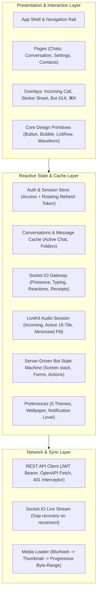

# System Design & Pages Design — Frontend Specification

This document provides the complete **System Design** and **Pages Design** specification for the Chat Application frontend, synthesized from:
- [`BACKEND_FEATURES_AND_DATA.md`](./BACKEND_FEATURES_AND_DATA.md)
- [`FRONTEND_PAGES_AND_NAVIGATION.md`](./FRONTEND_PAGES_AND_NAVIGATION.md)
- [`PACKS_AND_BOTS_FRONTEND_BRIEF.md`](./PACKS_AND_BOTS_FRONTEND_BRIEF.md)
- [`DESIGN_SYSTEM.md`](./DESIGN_SYSTEM.md)

---

## 1. System Architecture & Frontend State Model

### 1.1 Client Architecture Layers

### 1.2 Realtime Event Contract (Socket.IO)

The client maintains **one live socket connection per session** with automatic recovery:
1. **Message Lifecycle**:
   - `message:new` → Append to active feed or increment unread count on chat row.
   - `message:edit` → Replace message text, update `edited: true` flag.
   - `message:delete` → Soft-remove from feed (`deleteForMe` or `deleteForEveryone`).
   - `message:reaction` → Delta update on `{emoji, count, didIViewerReactWithThis}` (capped at 20 distinct emojis).
   - `message:read_receipt` → Increment sender's last-read pointer tick (single check `✓` to double check `✓✓`).
2. **Presence & Typing**:
   - `presence:update` → Update green dot and last-seen timestamp across open chats and contacts.
   - `typing:status` → Display "X is typing…" with a 4-second auto-timeout.
   - `uploading:status` → Display "attaching a file…" distinct from typing.
3. **Calls (LiveKit)**:
   - `call:incoming` → Surface non-modal Incoming Call banner over any screen.
   - `call:ended` / `call:missed` → Inject `voice_call` system message into chat history.
4. **Moderation & Account**:
   - `account:suspended` → Force-transition application into the **Suspended Account Screen**.
   - `chat:member_muted` / `chat:locked` → Live disable the composer with exact explanation banner.
5. **Reconnection Gap Recovery**:
   - On socket reconnect: emit `chat:sync_gap { chatId, lastMessageId }` to fetch dropped messages without a full reload.

---

## 2. Design Foundation & Design Tokens

Design tokens are exported in W3C format in [`frontend-design/figma-tokens.json`](../frontend-design/figma-tokens.json).

### 2.1 Color Palettes & 5 Supported Themes

The app does **not** use a simple light/dark binary toggle. It supports 5 curated themes across light and dark modes:

| Theme | Tone & Vibe | Light Canvas (`--bg`) | Light Surface (`--surface`) | Dark Canvas (`--bg`) | Accent (`--accent`) | Own Bubble Gradient |
|---|---|---|---|---|---|---|
| **Daybreak** | Modern Indigo & Violet (Default) | `#f4f5f9` | `#ffffff` | `#0f1019` | `#6366f1` / `#818cf8` | `linear-gradient(135deg, #6366f1, #8b5cf6)` |
| **Aurora** | Deep Teal & Emerald Glow | `#f0f8f8` | `#ffffff` | `#0b1416` | `#14b8a6` / `#2dd4bf` | `linear-gradient(135deg, #0d9488, #059669)` |
| **Meadow** | Organic Olive & Warm Amber | `#f7f7f2` | `#ffffff` | `#141611` | `#65a30d` / `#84cc16` | `linear-gradient(135deg, #65a30d, #4d7c0f)` |
| **Rose** | Subtle Coral & Soft Rosewater | `#faf5f6` | `#ffffff` | `#160d10` | `#e11d48` / `#fb7185` | `linear-gradient(135deg, #f43f5e, #e11d48)` |
| **Mono** | Minimalist Obsidian & Zinc | `#f4f4f5` | `#ffffff` | `#09090b` | `#18181b` / `#fafafa` | `linear-gradient(135deg, #3f3f46, #27272a)` |

#### Semantic Color Tokens:
- `--danger`: `#ef4444` (Light) / `#f87171` (Dark)
- `--success`: `#10b981` (Light) / `#34d399` (Dark)
- `--warning`: `#f59e0b` (Light) / `#fbbf24` (Dark)
- `--muted`: `#5b6178` (Light, WCAG AA 4.6:1 compliant) / `#878ea7` (Dark)

### 2.2 Typography Scale
- **Font Stack**: Latin: `Geist, sans-serif` · Persian/Arabic fallback: `Vazirmatn, sans-serif` · Numbers & Display: `Sora` · Code & Handles: `Geist Mono`.
- `text-caption`: 11px / 14px line-height (Timestamps, badges, metadata)
- `text-small`: 13px / 18px line-height (Subtitles, list row previews, secondary labels)
- `text-body`: 15px / 22px line-height (Message text, form inputs, default content)
- `text-title`: 17px / 24px line-height (Conversation headers, modal titles)
- `text-display`: 22px / 28px line-height (Auth titles, empty-state headers)
- `text-hero`: 28px / 34px line-height (Prominent display, banner headlines)

### 2.3 Elevation & Surfaces
- `elev-0`: Flat borders only (`border: 1px solid var(--border)`).
- `elev-1`: Header, composer, dropdowns (`box-shadow: 0 1px 3px rgba(0,0,0,0.06)`).
- `elev-2`: Dialogs, bottom sheets, incoming call banner (`box-shadow: 0 10px 30px rgba(0,0,0,0.12)`).
- `elev-glass`: Translucent blur reserved specifically for active call overlay (`backdrop-filter: blur(20px)`).

---

## 3. Core UI Primitives Specification

1. **Button**:
   - Variants: `primary`, `subtle`, `ghost`, `danger`.
   - Minimum touch target: `44px` height (`40px` for dense icon buttons with 44px hit-box).
2. **Avatar**:
   - Sizes: `32px` (feed), `40px` (list rows), `56px` (headers), `80px` (profile).
   - Dynamic presence ring: Green dot `#10b981` with background-color border gap.
3. **Message Bubble**:
   - **Own**: Right-aligned, `--own-bubble` gradient, white text.
   - **Other**: Left-aligned, `--surface` background, `--foreground` text, border.
   - **Corner-grouping algorithm**: 
     - First in run: Rounded 18px except bottom-inner corner (6px).
     - Middle in run: Both inner corners reduced (6px).
     - Last in run: Rounded 18px except top-inner corner (6px).
     - Single: All 18px with small tail.
4. **Voice Waveform Note**:
   - Duration label (`0:42`), circular Play/Pause button (`36px`), and dynamic canvas/bar waveform with 0.0–1.0 normalized bars. Played bars highlight with `--accent`.
5. **Reaction Pill Bar**:
   - Flex-wrap row under the bubble: `{emoji} {count}`.
   - Active state (if viewer reacted): Border + tinted background (`--accentSoft`).
   - Capped at 20 unique emojis; tapping toggles status.
6. **List Row**:
   - Avatar (`44px`), Title + timestamp, 2nd row: snippet preview + unread badge / mute icon / pin icon.
7. **Empty State**:
   - Icon container (48px rounded), single-line title, subtitle, and primary call-to-action.

---

## 4. Comprehensive Screen & Page Specifications

### Page A: Auth & Onboarding

#### A1. Login Screen
- **Components**: Logo mark, App title ("Chat"), Tab switcher (`Sign In` / `Register`), Identifier field (Email or Phone number), Password field with show/hide toggle, "Forgot password?" link, Primary "Sign In" button.
- **State: Account Locked**: Triggered after 5 failed attempts. Shows a warning banner: *"Account locked for 15 minutes due to multiple failed attempts."* Disabled submit button with live countdown timer.
- **State: Suspended Account (J2)**: Modal/full-screen blocking state: *"Your account has been suspended by an administrator. Reason: Terms of service violation. For inquiries, contact support."* (No in-app appeal flow).

#### A2. Register Screen
- **Components**: Username, Email, Password (with strength indicator), Optional First Name / Last Name, Optional Phone Number, "Create Account" button. Success auto-logs in directly into Chats (no email verification exists).

#### A3. Forgot Password Request (Admin-Mediated)
- **Component**: Single input field (Email, Phone, or Username).
- **Critical UX Copy Rule**: When submitted, display neutral confirmation: *"If an account matches that identifier, an administrator will review the recovery request."* **Never** promise an automated email link, as recovery links are generated by administrators manually in the admin panel.

#### A4. Reset Password Token Landing
- **Entry point**: Out-of-band link (`/reset-password?token=XYZ`, expires in 45 minutes).
- **Valid State**: New Password + Confirm Password fields → Success redirects to Login.
- **Expired/Invalid State**: Dead-end card: *"This password reset link has expired or has already been used. Please submit a new request."*

---

### Page B: App Shell & Navigation

- **Desktop Layout (≥ 900px)**:
  - Left icon rail (64px width): Logo, Chats icon (with global unread badge), Contacts icon, Settings icon, Status indicator, User Avatar profile shortcut.
  - Secondary drawer/sidebar (320px width): Search bar, Folder tabs, Chat list.
  - Main workspace: Active conversation pane or settings detail view.
  - Optional right inspector (320px width): Chat Info "Bento" panel.
- **Mobile Layout (< 900px)**:
  - Mobile Chat List screen with push-pop navigation to full-screen Mobile Conversation view.
  - Top app bar with Search and "New Chat" icon button.
  - Bottom navigation bar: `Chats` · `Contacts` · `Settings`.
- **Command Palette (`⌘K` / `Ctrl+K`)**:
  - Floating modal with quick-switch chat results, settings deep-links, and new chat shortcuts.
- **Connection Health Indicator**:
  - Subtle floating pill at the top of the chat view: *"Reconnecting to live server…"* auto-hides upon sync completion.

---

### Page C: Chat List & Folders

- **Folder Tabs Bar**:
  - Horizontal chip scroll: `All Chats`, `Direct (DMs)`, `Groups`, `Channels`, `Unread`, `+ Add Folder`.
  - Driven by server-side filter queries (not client-side array filters).
- **Chat Row Anatomy**:
  - Avatar: 44px round, with presence dot for 1:1 DMs or group member count badge.
  - Row 1: Chat title (bold when unread) + Last message timestamp (e.g. `10:42 AM`, `Yesterday`).
  - Row 2: Sender prefix (in groups) + Message snippet preview (or `[Voice Note]`, `[Photo]`, `[Sticker]`).
  - Badges: Pin icon (if pinned), Mute bell slash (if muted), Mention badge (`@`), Unread count pill (`3`).
- **Row Actions**:
  - Desktop: Hover action icons (Pin, Mute, Delete).
  - Mobile: Swipe right to Pin/Mute; swipe left to Archive/Delete.

---

### Page D: Rich Conversation View

- **Header Bar**:
  - Chat avatar, Title, Member count (or "online" status for 1:1 DMs), Audio Call button, Search in Chat button, Overflow menu (`...`).
  - Clicking header opens the **Chat Info (Bento)** panel.
- **Pinned Messages Strip**:
  - Compact sticky bar directly under the header showing current pinned message preview (`1 of 3 pinned messages`). Tap scrolls and highlights that message.
- **Message Feed**:
  - Date dividers (`Today`, `October 24, 2026`).
  - Text bubbles with inline Markdown and `@mention` links.
  - Voice notes with audio waveform, duration, and playback scrub.
  - Image attachments: Progressive blurhash placeholder → thumbnail → full resolution with lightbox on tap.
  - Video attachments: Video thumbnail with duration pill and inline playback with byte-range scrub support.
  - Reply Quote Snippet: Mini box above message text with accent vertical bar, sender name, and preview snippet.
  - Read Receipt Ticks: Single tick `✓` (sent) → Double tick `✓✓` (read by recipient).
  - "Seen By" List: On own messages only, clicking ticks opens viewer popup with read timestamps.
- **Composer Anatomy**:
  - Left icon: Attachment tray toggle (`+`).
  - Input area: Auto-expanding textarea (1 to 5 lines) with `@` mention autocomplete popup.
  - Right icons: Emoji picker trigger, Sticker/GIF trigger, Microphone button (hold to record, swipe up to lock).
  - Send button: Replaces mic button when text is entered.
  - Disabled States:
    - Channel non-admin: *"Only administrators can post in this channel."*
    - Admin-muted: *"You have been muted by an administrator."*
    - Locked chat: *"This conversation is currently locked."*

---

### Page E: Packs, Stickers & Animated Emoji (Brief §1)

This section fulfills all requirements of [`PACKS_AND_BOTS_FRONTEND_BRIEF.md`](./PACKS_AND_BOTS_FRONTEND_BRIEF.md).

#### E1. Telegram-Style Pack Preview Sheet
- **Trigger**: Tapping any sticker or animated emoji in chat, opening a pack invite link (`/packs/:slug`), or clicking a pack row in search results.
- **Layout (Bottom Sheet on Mobile / Centered Modal on Desktop)**:
  - Header: Pack thumbnail, Pack name, Creator name, Total stickers/emojis count.
  - Share link button (`Copy Link`).
  - Items Grid: 4-column scrollable grid of all stickers/emojis in the pack.
  - Action Footer:
    - If user is NOT subscribed: Large primary button: **`Add Stickers`** (or `Add Emoji Pack`).
    - If user IS subscribed: Destructive/Subtle button: **`Remove Pack`**.
  - **Critical Rule**: Users *cannot* send items directly from this preview modal; they must add the pack to their collection first.

#### E2. Animated Emoji Tab in Emoji Picker
- The emoji picker displays two distinct tabs:
  1. **Base Emoji**: Static client-side Unicode emoji picker (zero backend calls, no pack concept).
  2. **Animated Emoji**: Displays animated GIFs grouped by the user's subscribed emoji packs from `GET /v1/packs/mine?type=emoji`. If no packs are subscribed, presents an empty state with "Browse Emoji Packs" linking to discover/bot.

#### E3. Sticker Picker
- Three segmented tabs:
  1. **Mine**: Subscribed packs (owned + added), rendered as a top horizontal pack avatar bar + vertical sticker grid.
  2. **Public Packs**: Discover trending packs, search by keyword, view items count, tap to open E1 preview sheet.
  3. **Global (Giphy)**: Giphy sticker search and trending with mandatory **"Powered by GIPHY"** attribution badge.

---

### Page F: Server-Driven Bot GUI Surface (Brief §2)

Fulfills the server-driven Bot framework from [`PACKS_AND_BOTS_FRONTEND_BRIEF.md`](./PACKS_AND_BOTS_FRONTEND_BRIEF.md) §2:
- **No text input**: The bot interface has **no chat input box or command line prompt**. It is 100% GUI-driven through server-returned JSON screens (`BotMenuScreen`).

#### F1. Generic Bot Screen Renderer
The client renders:
- `title` & `subtitle`: Large header text.
- `items[]`: Interactive list rows (with title, subtitle, thumbnail icon, badge, and bound `action`).
- `actions[]`: Bottom page-level buttons (e.g. `+ Create Pack`, `Add by Link`).
- `toast`: Auto-triggers a temporary snackbar when a new screen loads.

#### F2. Action Handlers
- `navigate`: Fetches `GET /v1/bots/:key/menu?screen=<action.screenId>` and transitions screen.
- `invoke`: Fires `POST /v1/bots/:key/action` with parameters. If `confirmText` is provided, displays a confirmation modal first.
- `form`: Renders a structured form modal based on `action.fields`:
  - `text` / `textarea`: Standard inputs.
  - `keywords`: Tag/chip input for multiple emoji/keyword tags (e.g. `["😂", "lol", "laugh"]`).
  - `file`: Drag-and-drop file upload zone supporting multi-select (`files[]`).
  - Submitting sends multipart POST to `/v1/bots/:key/action/upload` and re-renders the returned screen.

#### F3. Reference Bot: `pack-manager`
- Screen 1: `home` → Buttons for "My Sticker Packs", "My Emoji Packs", "Create a Pack", "Add by Invite Link".
- Screen 2: `my-packs` → List of owned/subscribed packs.
- Screen 3: `pack-detail` → Owner actions: "Add Items", "Edit Details", "Copy Link", "Delete Pack", plus individual item rows with destructive "Remove" buttons.

---

### Page G: Audio Calling System (LiveKit-backed)

#### G1. Incoming Call Banner/Modal
- **Trigger**: Live socket event `call:incoming`. Can overlay **any screen** in the app.
- **Visuals**: Elevated card with caller avatar, caller name, chat name (for group calls), and ringing pulse animation.
- **Controls**: Green `Accept` button (opens active call) and Red `Decline` button.

#### G2. Active Call View
- **Visuals**: Full-screen or modal overlay with dark glassmorphic background (`backdrop-filter: blur(24px)`).
- **Participant Grid**: Up to 16 participant audio tiles:
  - Avatar, Name, Mic status icon (muted/speaking).
  - Active speaker indication: Glowing green animated audio ring around avatar.
  - Connection quality indicator (3-bar cellular icon).
- **Controls Toolbar**:
  - `Mute / Unmute Mic` toggle button.
  - `Audio Output / Mic Select` dropdown.
  - `Minimize Call` button (collapses to floating pill).
  - `Leave Call / End Call` red button.

#### G3. Minimized Floating Call Pill
- Persistent floating capsule widget (e.g. bottom-right on desktop, top bar on mobile).
- Displays live call duration (`03:24`), active speaker name, and one-tap Return button + Hang-up icon.

#### G4. In-Feed Call Log
- System message rendered in conversation feed:
  - `"Voice Call ended · 14m 32s"` or `"Missed Voice Call"`.

---

### Page H: Chat Info & Management ("Bento" Layout)

- **Header Section**: Chat avatar gallery (can scroll through past avatars), title, description, invite link with copy button.
- **Bento Metric Tiles**:
  - `Members Tile`: Total member count, online count.
  - `Media Gallery Tile`: Preview thumbnails of photos, videos, and files shared.
  - `Wallpaper Tile`: Current active per-chat wallpaper thumbnail.
  - `Tags Tile`: Associated folder tags.
- **Management Sub-screens**:
  - **Member List**: Shows every member with their role badge (`Owner`, `Admin`, `Member`). Admin actions per row: `Promote to Admin`, `Mute Member`, `Ban Member`, `Remove`.
  - **Banned Users List**: List of banned users with one-tap `Unban` action.

---

### Page I: Wallpaper Studio (Global & Per-Chat)

- **Canvas Preview**: Live chat background preview with simulated message bubbles.
- **Customization Controls**:
  - Media Picker: Preset gradients, upload custom image, or upload looping MP4 video.
  - `Blur Slider`: 0px to 30px backdrop blur.
  - `Dim Slider`: 0% to 80% dark overlay.
  - `Brightness Slider`: 50% to 150%.
  - `Fit Mode`: Cover, Contain, Tile.
  - `Parallax Effect`: On/Off toggle.
- **Shared Per-Chat Wallpaper Banner**: When another member sets a wallpaper, recipient sees an inline prompt: *"Sarah shared a new chat wallpaper. [Accept] [Dismiss]"*.

---

### Page J: Unified Search & Contacts

#### J1. Global Search
- Three privacy-scoped tabs:
  1. **People**: Matches username, first name, last name. Never exposes phone number or email address.
  2. **Channels**: Matches public channel/group names and descriptions. Excludes private DMs.
  3. **Messages**: Matches text across chats the user is actually a member of. Clicking jumps directly to that message in context.

#### J2. Contacts Address Book
- **Contact List**: Alphabetical roster with avatar, custom display name, online presence dot, and direct "Send Message" action.
- **Add Contact Dialog**: Four lookup methods:
  - By User ID (from a profile view).
  - By Exact Username.
  - By Exact Phone Number.
  - By Exact Email (surfaces a notice: *"Search rate-limited to 10 queries/minute"*).
- **Mutual-Contact Privacy Reveal**: User profiles strictly show Email and Phone Number **only** when both users have each other saved as mutual contacts.

---

### Page K: Settings Shell

Desktop master-detail layout (Sidebar list + Detail pane) / Mobile drill-down navigation:
1. **Profile**: Avatar gallery selector, Name, Username (`@handle`), Bio, Phone, Email.
2. **Appearance**: 5-theme selector (Daybreak, Aurora, Meadow, Rose, Mono), Big Emojis toggle, Quick-reaction emoji picker.
3. **Notifications**: Notification level (`All Messages`, `Only Mentions`, `None`). Explicit educational notice: *"Web app notifications are foreground-only. Android devices receive native push notifications via FCM."*
4. **Chat Folders**: Custom folder manager. Configure folder name, include/exclude chat types, tags, and specific chats, plus "Only Unread" toggle.
5. **Security & Active Sessions**: Change password, list active sessions (Device type, IP address, last active time), Revoke button per session, and "Log Out Everywhere" button.
6. **Account Deletion**: Warning explaining permanent deletion of packs/wallpapers and anonymization of message history to "Deleted User". Requires password confirmation.

---

### Page L: Separate MFA-Gated Admin Panel

Internal moderation and management console with a distinct dark aesthetic and isolated navigation:
1. **Admin Login (L1)**: Three required fields: Email, Password, and 6-digit TOTP code (Authenticator app).
2. **Password Recovery Queue (L2)**: Pending password recovery requests. Approving a request generates a one-time 45-minute recovery URL to be copied and delivered out-of-band to the user.
3. **Reports Queue (L3)**: Filter by status (Pending, Resolved) and target type (Message, User, Channel). Displays reporter notes, reported content snippet, and resolution action buttons.
4. **User Moderation (L4)**: Search user by ID or username. Actions: Time-boxed suspension (e.g. 24 hours, 7 days, Permanent), Send official Warning DM, View moderation audit log.
5. **Channel Moderation (L5)**: Lock channel (blocks posting), hard-hide offending message, force-remove member.
6. **Media Housekeeping (L6)**: Table of orphaned unreferenced media files with preview, file size, and permanent Hard Delete action.

---

## 5. Roles & Permissions Matrix

| Capability / Action | Plain Member | Chat Admin | Chat Owner | Platform Admin (Admin Panel) |
|---|:---:|:---:|:---:|:---:|
| Send text, voice, media, reactions | Yes | Yes | Yes | N/A |
| Post in broadcast channel | No | Yes | Yes | N/A |
| Pin / Unpin messages | No | Yes | Yes | N/A |
| Delete message for everyone | Author only | Yes | Yes | Yes (Hard-hide) |
| Edit message | Author only | Author only | Author only | No |
| View "Seen By" receipt list | Author only | Author only | Author only | N/A |
| Mute / Ban members | No | Yes | Yes | Yes |
| Rename / Re-describe chat | No | Yes | Yes | Yes |
| Delete chat entirely | No | No | Yes | Yes |
| Create / Edit sticker & emoji packs | Yes (own) | Yes (own) | Yes (own) | Yes |
| Approve password recovery request | No | No | No | Yes (MFA required) |
| Suspend / Unsuspend user account | No | No | No | Yes (MFA required) |
| Permanently purge orphaned media | No | No | No | Yes (MFA required) |

---

## 6. Figma Autolayout & Component Structure Guidelines

For teams translating this system into Figma artboards and libraries:
1. **Frames Hierarchy**:
   - Master Artboards: Desktop (`1440 × 900`), Mobile (`390 × 844`), Modals (`430 × 700`).
   - All components must use **Autolayout (V/H)** with standard padding tokens (`4px`, `8px`, `12px`, `16px`, `24px`).
2. **Component Sets (Variants)**:
   - `Bubble`: Variants = `Direction (Own | Other)`, `Type (Text | Voice | Media | Video | Reply | System)`, `Grouping (Single | First | Middle | Last)`.
   - `Button`: Variants = `Style (Primary | Subtle | Ghost | Danger)`, `Size (Sm | Md)`, `State (Default | Hover | Active | Disabled | Loading)`.
   - `ListRow`: Variants = `Active (True | False)`, `Type (Chat | Contact | BotItem | Settings)`.
   - `Theme Variables`: Bind color variables to the 5 modes defined in `figma-tokens.json`.
