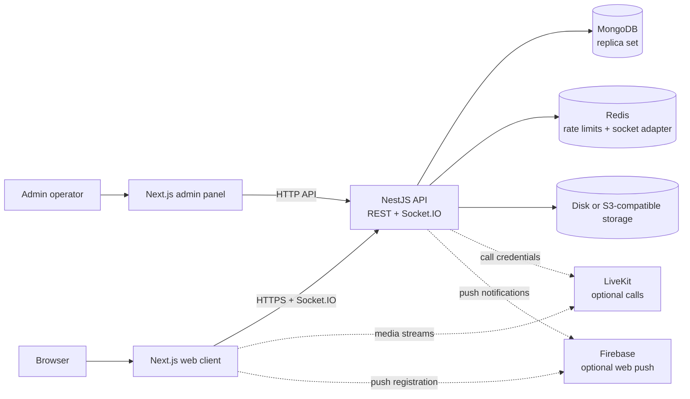

# Architecture overview

Chat separates the user interface, application API, and operational services. The diagram shows the main runtime dependencies; optional integrations are marked below.

## Components

- **Web client:** Next.js, React, TanStack Query and Socket.IO client. Browser sessions use an in-memory access token and an HttpOnly refresh cookie.
- **API:** NestJS exposes application routes and real-time events. Authorization and business rules are enforced on the server.
- **Persistence:** MongoDB stores application data; Redis supports rate limiting and cross-process Socket.IO delivery.
- **Media:** uploads use local disk or an S3-compatible object store.
- **Admin panel:** a separate Next.js application for administrative workflows.
- **Optional services:** LiveKit supports calls; Firebase enables browser push when configured. The local quick start does not provision either integration.

The API exposes interactive documentation at `/docs`. For deeper implementation details, see the [backend](../backend/README.md), [frontend](../frontend/README.md), and [documentation index](README.md).
